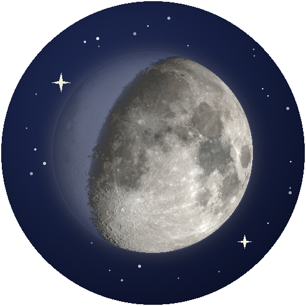

<p align="center">
  
</p>

<h1 align="center">Lunar Phase tray app</h1>

A top-bar (AppIndicator) app for Linux that shows the current Moon phase as its icon.

**Menu:** phase name, illumination %, waxing/waning, Moon age and % of the cycle,
countdowns to the next full moon, new moon and quarter, distance and apparent size,
the zodiac sign the Moon is in, and, once a location is set, the next moonrise and
moonset and where the Moon is in your sky right now.

**Details window** (from the menu, or middle-click the icon): a picture of the Moon
as it looks this hour from NASA's SVS *Dial-A-Moon*. Click the picture to open the
full 730×730 image. You also get the lunation progress, phase angle and every
upcoming principal phase with its date and countdown. When you're offline it shows
a simulated rendering instead.

**Settings submenu:** set your location, show the percentage next to the icon,
southern-hemisphere (rotated) view, turn NASA downloads on or off, start at login.

**Location:** enter latitude, longitude and optionally a timezone, or press the button
to use your system timezone's reference city. Setting a location adds moonrise, moonset,
the time and height of the Moon's highest point, and its current altitude and compass
direction. Times are shown in the timezone you chose. Phase instants (full moon, new moon
and so on) are the same moment worldwide, so the location changes only which clock they're
shown on. Nothing is looked up online: the location stays in your config file.

## Run

```bash
./lunar_tray.py            # tray app
./lunar_tray.py --details  # also open the details window right away
./lunar_tray.py --print    # print current data to the terminal and exit
python3 moonphase.py 2026-03-03T11:30   # data for any UTC time
python3 moonphase.py 2026-11-20T00:00 51.48 0.0   # plus rise/set/transit for lat lon
./install.sh               # app-menu launcher + autostart, then start it
```

Requires: `python3-gi`, `gir1.2-gtk-3.0`, `gir1.2-ayatanaappindicator3-0.1` (or the older
`gir1.2-appindicator3-0.1`), `python3-cairo`, `python3-numpy`, `python3-pil`. GNOME needs the
AppIndicator extension, which Ubuntu ships by default.

## How it works

- `moonphase.py` is pure-Python astronomy: the Moon's position comes from the main terms of
  the ELP-2000/82 series and the Sun's from Meeus ch. 25. Illumination comes from the phase
  angle. The times of new moon, first quarter, full moon and last quarter are found by
  root-finding on the Sun–Moon elongation, and they agree with published tables to about a minute.
  Moonrise, moonset and transit come from scanning 48 hours of altitude in 10-minute steps and
  bisecting each horizon crossing. They match the US Naval Observatory to the minute.
- `moonrender.py` draws the tray icons with cairo, plus the offline fallback picture.
- Icons, downloaded images and the lock file go in `~/.cache/lunar-phase-tray/`. Settings
  are saved in `~/.config/lunar-phase-tray/config.json`.

## Credits

Moon imagery, including the photo in the logo, is from the
[NASA Scientific Visualization Studio](https://svs.gsfc.nasa.gov/) *Dial-A-Moon* (public domain).
`tools/make_logo.py` builds `assets/logo.png` from one of those images.
